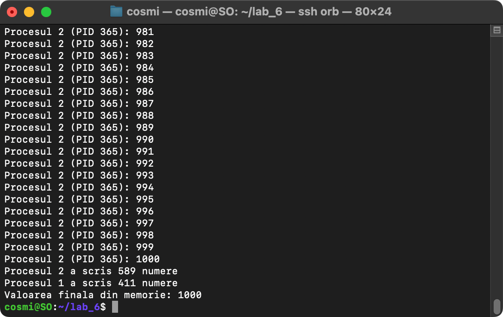
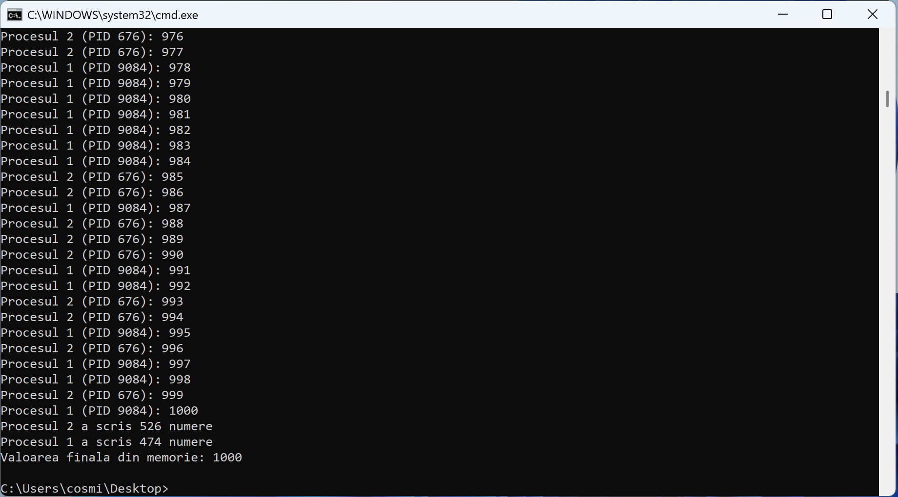

# Laborator 6 - Memorie partajata si semafor

## Cerinta

Doua procese numara de la 1 la 1000 folosind un obiect mapat in memorie. Fiecare proces:

- citeste memoria
- da cu banul (random(2)) si, cat timp cade 2, scrie in memorie urmatorul numar
- elibereaza semaforul

Semaforul asigura ca un singur proces lucreaza cu memoria la un moment dat.

## Cum functioneaza

1. Procesul initial creeaza memoria partajata (un numar, initial 0) si un semafor cu valoarea 1.
2. Porneste al doilea proces. Ambele deschid memoria si semaforul dupa nume.
3. Fiecare proces repeta:
   - asteapta semaforul
   - citeste numarul din memorie
   - cat timp `rand() % 2 == 1`, scrie urmatorul numar si il afiseaza
   - elibereaza semaforul
4. Cand un proces citeste 1000, se opreste si afiseaza cate numere a scris.
5. La final, procesul initial afiseaza valoarea din memorie, care trebuie sa fie 1000.

## Diferente intre Linux si Windows

| | Linux | Windows |
|---|---|---|
| Memorie partajata | `shm_open`, `mmap` | `CreateFileMapping`, `MapViewOfFile` |
| Semafor | `sem_open`, `sem_wait`, `sem_post` | `CreateSemaphore`, `WaitForSingleObject`, `ReleaseSemaphore` |
| Al doilea proces | `fork` | `CreateProcess` cu argumentul `copil` |

## Compilare si rulare

Linux:

```
g++ linux.cpp -o linux -pthread
./linux
```

Windows:

```
g++ windows.cpp -o windows.exe
windows.exe
```

## Rulare

In ambele cazuri valoarea finala din memorie este 1000.

### Linux

Procesul 2 a scris 589 de numere, iar procesul 1 a scris 411.



### Windows

Procesul 2 a scris 526 de numere, iar procesul 1 a scris 474.


